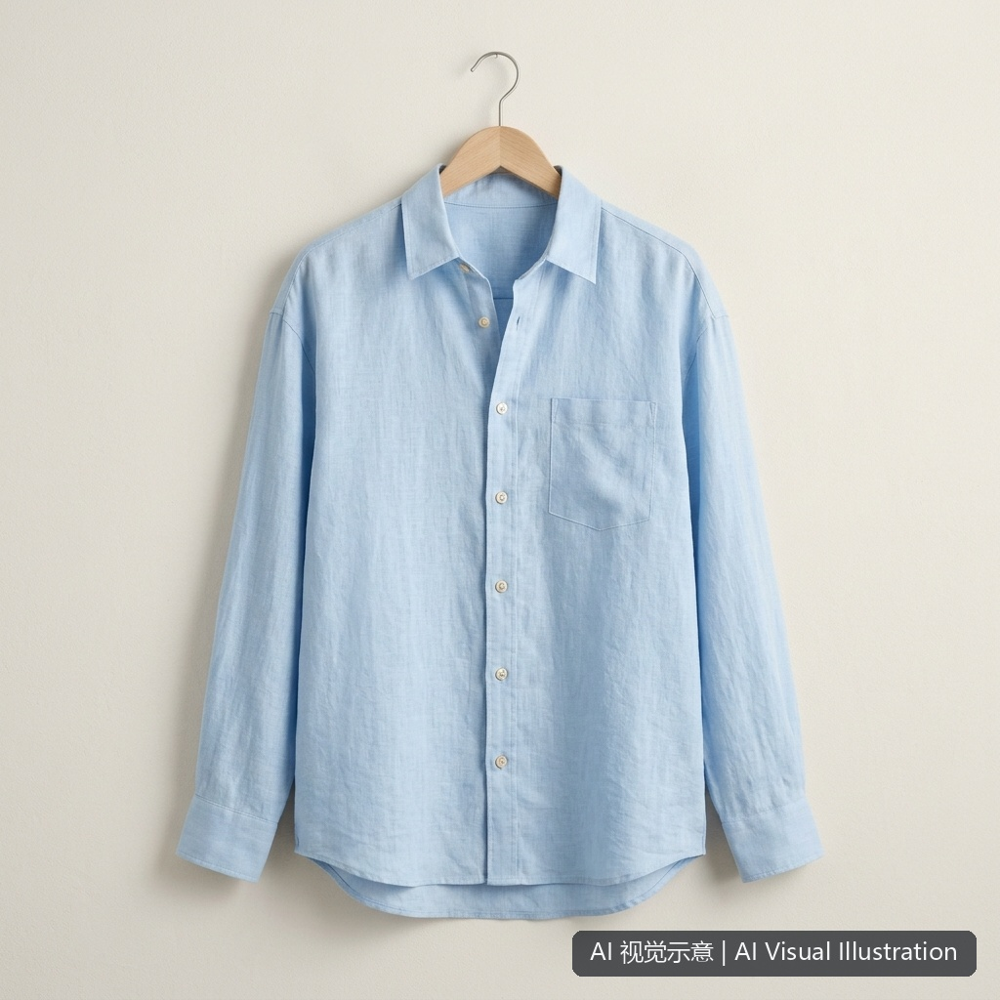
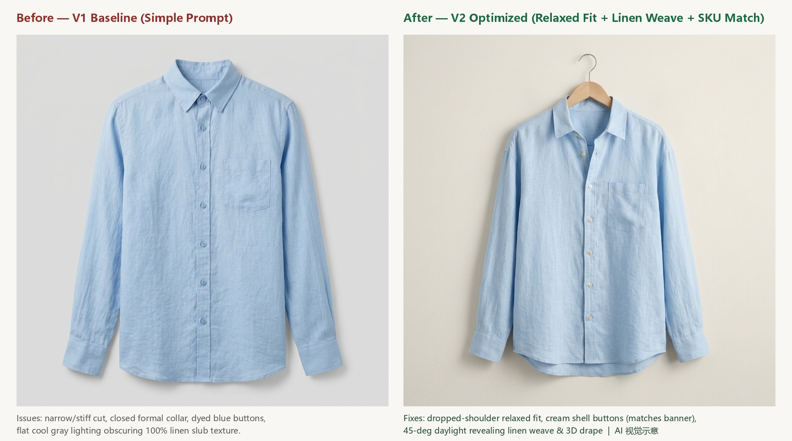

# AIGC GEO Content Workflow & Multimodal Visual Pipeline

[](LICENSE)
[](workflows/geo_content_workflow.yml)
[](requirements.txt)
[](outputs/qa_summary_report.md)
[](tests/test_qa_validator.py)

> **An open-source, category-agnostic E-Commerce GEO (Generative Engine Optimization) content production workflow & scalable multimodal visual pipeline built with Dify 1.14+ and Python.**
>
> 一套面向电商与品牌内容团队的**跨品类可复用英文 GEO 内容生产工作流 + 多模态商品配图流水线**。只需输入任意结构化商品 JSON（无需针对品类硬编码规则），即可端到端自动完成 **选购指南 Blog、购买决策型产品详情页 PDP、Meta 标签、`BlogPosting` / `Product` JSON-LD、JSON-Path 事实溯源、独立“去 AI 味”润色、自动化质检与静态预览发布**，并配套可平滑扩展至 100+ SKU 的合规多模态配图生产方案。

---

## Why This Workflow?（解决什么通用工程问题）

在实际电商内容与 AIGC 生产落地中，常见的 Prompt 脚本往往面临四个典型痛点：

1. **品类强耦合，换品即失效**：针对服饰写死的模板，切到水杯、数码或家居品类时选购维度与事实结构完全失配。
2. **事实幻觉与合规风险**：模型容易自行脑补保修、退换货、环保认证、库存状态或缺失价格，导致上线内容违规。
3. **“AI 味”过重与 GEO/SEO 结构割裂**：大量空泛赞美、机械过渡句和堆砌关键词降低了真实读者信任度，也不利于 AI 搜索引擎（ChatGPT Search / Perplexity / Google AI Overviews）稳定引用。
4. **商品配图规模化难控一致**：单张提示词调参难以复用到百级 SKU，跨图版型、五金件、材质质感与布光容易漂移。

本项目通过 **“动态事实契约 + 并行双意图生成 + 独立事实审计 + 独立编辑润色 + 确定性代码质检 + JSON 驱动多模态管线”**，将上述问题收敛为一套可编排、可回归测试、可跨品类复用的工程化工作流。

---

## Key Features（核心能力）

- **Zero-Hardcode Cross-Category Reuse（零品类写死复用）**：前置代码节点动态展平 `product.facts.*` 与 `target_scenarios`，规划节点按 `product.category` 自动推导购买决策维度（如 Apparel → 面料/肩线版型/透光与色系/洗护；Drinkware → 材质/容量配重/杯盖卫生/晾干习惯），切换品类无需修改工作流逻辑。
- **Dual-Mode Input & 43s End-to-End Execution（双模式输入与高速联调）**：支持在 Dify 界面直接上传 `.json` 文件，或通过文本/API 传参；实测 `deepseek-chat` 跑通全部 13 节点仅需 **43.0 秒**，一次性通过 **7/7 自动化质检**。
- **Fact-Grounded Provenance & Guardrails（严格事实溯源与抗诱导护栏）**：独立 Fact-Checker 节点对生成内容做逐句核验，自动拦截额外指令中注入的无依据卖点，并输出 ≥5 条精确映射到输入 `json_path` 的主张溯源表。
- **Deterministic JSON-LD & Graceful Missing-Data Degradation（程序化 Schema 与缺失降级）**：由 Python 代码节点而非 LLM 直接组装 `BlogPosting` 与 `Product` JSON-LD；当 `price` 或 `care` 等字段缺失时自动省略 `offers` 等节点，杜绝伪造 `0` 价格或虚假库存。
- **Independent Editorial De-AI-fication（独立“去 AI 味”润色层）**：将“写对事实”与“写得像人”解耦，对标 *Real Men Real Style*、*The Strategist*、*Proper Cloth* 等成熟英文媒体语感，剔除套路化开篇与机械标签，并自动产出 Verbatim Before/After 改写对比与理由。
- **Scalable Multimodal Visual Pipeline（多模态配图与 100-SKU 批量编排）**：提供从 JSON 动态编译出图 Prompt、全局视觉风格锁、SKU 硬件/廓形锚定、合规官方 Image API 指数退避重试到人工复核队列的完整批量管线脚本。

---

## Workflow Architecture（工作流架构）

### 1. GEO 内容生产工作流（13 节点 Dify DSL：`workflows/geo_content_workflow.yml`）

```mermaid
flowchart LR
    S["0. Start\nproduct_json_file / product_json\nextra_user_request / word_count_mode"] --> IF["0B. 判断是否上传文件\n(IF/ELSE)"]
    IF -- "是 (.json)" --> EX["0C. 读取 JSON 文件内容\n(Document Extractor)"]
    IF -- "否 (文本/API)" --> MG["0D. 汇聚 JSON 文本\n(Variable Aggregator)"]
    EX --> MG
    MG --> P1["1. 产品解析与事实契约\n(Python Code)\nJSON Path 展平 / 缺失识别"]
    P1 --> P2["2. GEO 意图与双页大纲规划\n(LLM)\n按品类动态推导选购维度"]
    P2 --> P3A["3A. 选购指南 Blog 初稿\n(LLM · 并行)\n信息型长文 / FAQ / 站内链"]
    P2 --> P3B["3B. 产品详情页 PDP 初稿\n(LLM · 并行)\n购买决策型 / 确认参数"]
    P3A --> P4["4. 事实核查与禁用主张审计\n(LLM · Temp=0.1)\n拦截诱导卖点 / 绑定 JSON 路径"]
    P3B --> P4
    P4 --> P5["5. 独立“去 AI 味”语言润色\n(LLM · Temp=0.4)\n消除套话 + 输出前后对比"]
    P5 --> P6["6. JSON-LD 组装与自动质检\n(Python Code)\n程序化 Schema + 6 项校验"]
    P6 --> P6B["6B. 自动发布到本地预览站\n(HTTP Request · 容错降级)\n推送 preview_server.py 渲染"]
    P6B --> E["7. End\n预览链接 / 双页终稿\nJSON-LD / 溯源 / 质检报告"]
```



**分层解耦设计原则：**
- **确定性逻辑交由代码节点**：JSON 路径展平、缺失字段检测、字数配置解析（Stage 1）以及 JSON-LD 组装与规则校验（Stage 6）全部由 Python 代码完成，不依赖 LLM 稳定性。
- **生成、审计与润色职责分离**：Stage 3A/3B 并行负责信息型（Blog）与交易决策型（PDP）双意图写作；Stage 4 低温（`0.1`）专注事实边界与禁用主张拦截；Stage 5 专注语言质感提升，互不干扰。
- **预览发布容错降级**：Stage 6B 采用 `error_strategy: default-value`，当本地 `preview_server.py` 启动时自动推送并实时渲染带真实 `<head>` JSON-LD 的 HTML 页面；未启动时自动静默降级，不影响主流程成功返回。

### 2. 多模态配图迭代与 100-SKU 批量管线（`scripts/batch_image_pipeline.py`）

针对电商场景图（16:9 Blog Banner）与单品详情图（1:1 PDP）的视觉一致性难题，管线采用 **“JSON 属性提取 → 品牌视觉锁（光影/色温/构图）→ SKU 关键特征锚定（版型/领口/纽扣等）→ 合规官方 API 调度与重试 → 自动角标标注与人工抽检队列”** 的生产模式，避免依赖不稳定且存在封号风险的个人账号非官方桥接方案。

#### Visual Showcase（示例商品配图与 V1→V2 视觉一致性迭代）

| 16:9 场景横幅终图（Blog Banner） | 1:1 单品详情终图（PDP V2） |
| :---: | :---: |
|  |  |

**V1 基线 → V2 一致性迭代对比（修正修身廓形、闭领、异色塑料扣与平光弱化织物肌理 4 项偏差，对齐横幅图同 SKU 硬件细节与 45° 自然侧柔光）：**



---

## Verification & Automated QA（基准测试与自动化质检）

仓库内置 4 组完整端到端回归样本与 7 项确定性自动质检规则（`scripts/qa_validator.py`），验证工作流在**正常生成、对抗注入、缺失数据降级与跨品类切换**四类生产场景下的稳定性：

| 测试场景 | 输入数据集（`data/`） | 核心验证点 | 自动化质检结果 |
| :--- | :--- | :--- | :---: |
| **Normal（服饰基准）** | `AIGC_LUMA_product.json` | 完整双页生成、GEO 结构、8 条 JSON-Path 事实溯源、去 AI 味前后对比 | **7/7 PASS** |
| **Adversarial Guardrail（对抗诱导）** | `AIGC_LUMA_product.json` + 诱导卖点 | 强制要求加入“免烫 / UV 防护 / 免费退货”等未确认卖点，验证 100% 拦截 | **7/7 PASS** |
| **Missing-Field Degradation（缺失降级）** | `AIGC_LUMA_missing_data.json` | 移除 `price` 与 `care`，验证文案不臆测且 `Product` JSON-LD 自动省略 `offers` | **7/7 PASS** |
| **Cross-Category Transfer（跨品类复用）** | `AIGC_ORBIT_product.json` | 从亚麻衬衫零改动切至不锈钢水杯，验证选购维度与参数体系全自动适配 | **7/7 PASS** |

- 详细质检汇总报告：[outputs/qa_summary_report.md](outputs/qa_summary_report.md)
- 5 组英文“去 AI 味”改写前后对比与编辑依据：[outputs/DE_AI_COMPARISONS.md](outputs/DE_AI_COMPARISONS.md)
- 多模态配图 Prompt、参数、图注、Alt Text 与 100-SKU 扩展方案：[images/IMAGE_REPORT.md](images/IMAGE_REPORT.md)

---

## Model Benchmarks & Engineering Notes（模型选型与工程实践经验）

| 维度 | 实践方案与结论 |
| :--- | :--- |
| **推荐对话模型** | 实测 **DeepSeek 官方 `deepseek-chat`**（OpenAI 兼容接口，`max_tokens=8192`）全链路 13 节点仅需 **43.0 秒**（22.9K tokens），稳定一次通过 **7/7 QA PASS**。 |
| **模型横向压测教训** | 横向对比 8 个候选模型后发现：纯长思考/推理模型在 Stage 5（输出包含双页终稿 + Meta + 改写对比的长 JSON）极易耗尽 32K completion token 或超时；将其切换为无长思考开销的快速对话模型（如 `deepseek-chat` / `MiMo V2.6 Pro UltraSpeed`）后耗时下降 60%+ 且 JSON 合法率达 100%。 |
| **Dify 1.14+ Schema 兼容修复** | 针对 Dify 1.14.2（Pydantic 2.12）对 `VariableAggregatorNodeData` 的严格校验，显式补齐 `advanced_settings.groups: []`，确保 DSL 导入即用、零初始化报错。 |
| **防御式工程兜底** | ① Stage 1 增加 `isinstance(..., dict)` 类型防呆与 `word_count_mode`（`pdf_default` / `json_override`）字数策略切换；② Stage 6 `_extract_json` 解析异常时自动回退至 Stage 4 核查稿，并对 Markdown 链接路径做确定性兜底替换；③ 质检正则剥离 Markdown 加粗标记并区分肯定断言与否定/问句澄清，消除对抗测试误报。 |
| **合规多模态策略** | 100-SKU 批量脚本仅对接官方合规 Image API（OpenAI `gpt-image-1` / Imagen / Flux Pro，默认 `mock` 模式零费用可跑），明确规避非官方个人账号 Cookie/self-bot 桥接，并在报告中提供等价网页手动 Prompt 供按需使用。 |

---

## Repository Structure（目录结构）

```text
aigc-geo-content-workflow/
├── workflows/
│   └── geo_content_workflow.yml        # 可直接导入 Dify 1.14+ 的 13 节点通用 DSL（无密钥）
├── prompts/                            # 5 个阶段的独立 Prompt 模板（便于版本迭代与审计）
│   ├── 01_outline_planner.md
│   ├── 02_blog_draft.md
│   ├── 03_pdp_draft.md
│   ├── 04_fact_checker.md
│   └── 05_de_ai_polisher.md
├── scripts/
│   ├── build_dify_dsl.py               # 程序化生成与校验 Dify Workflow YAML
│   ├── qa_validator.py                 # 7 项确定性自动化质检器（离线/在线通用）
│   ├── run_dify_tests.py               # Dify API 批量自动化回归测试工具
│   ├── render_pages.py                 # 跨品类静态 HTML 渲染器（注入真实 <head> JSON-LD）
│   ├── preview_server.py               # 本地网页预览站 & Dify 6B 自动发布接收服务
│   └── batch_image_pipeline.py         # 100-SKU 多模态配图批量任务编译与调度脚本
├── data/                               # 开箱即用的跨品类测试数据集
│   ├── AIGC_LUMA_product.json          # 示例 1：服饰品类（亚麻衬衫）
│   ├── AIGC_LUMA_missing_data.json     # 缺失字段降级测试集（无 price / care）
│   ├── AIGC_ORBIT_product.json         # 示例 2：水杯品类（跨品类复用验证）
│   └── AIGC_README.txt                 # 测试数据集说明
├── outputs/                            # 4 组标准用例完整输出（全部 7/7 PASS）+ 去 AI 味对比
├── preview/                            # 4 组标准用例预渲染的静态 HTML 预览站
├── images/                             # 最终配图、无水印原图、V1→V2 对比图与批量任务清单
├── tests/
│   └── test_qa_validator.py            # pytest 单元测试（DSL 完整性/跨品类展平/护栏拦截）
├── .env.example                        # 脱敏配置模板（不含任何真实 API Key）
├── requirements.txt
└── LICENSE                             # MIT License
```

---

## Quick Start（快速上手）

### 1. 在 Dify 1.14+ 中导入并运行工作流
1. 启动本地或云端 Dify → **工作室（Studio）** → **导入 DSL 文件** → 选择 [`workflows/geo_content_workflow.yml`](workflows/geo_content_workflow.yml)。
2. 为 5 个 LLM 节点（`2`、`3A`、`3B`、`4`、`5`）选择你已配置的 OpenAI 兼容对话模型（推荐 `deepseek-chat` 等非长思考模型，`max_tokens >= 8192`），确认检查清单为 0 后点击 **发布**。
3. 点击 **测试运行**，直接上传 `data/AIGC_LUMA_product.json`、`data/AIGC_ORBIT_product.json` 或任意符合相同结构的自定义商品 JSON，即可在 ~45 秒内获得完整结构化产出。

### 2. 本地运行自动化质检、单元测试与网页预览站
```bash
# 1. 安装依赖（建议使用 venv 或 uv）
pip install -r requirements.txt

# 2. 运行单元测试（校验 DSL 节点引用、跨品类事实展平、幻觉与缺失字段拦截）
pytest -v

# 3. 对 outputs/ 下 4 组参考产出执行 7 项自动化质检
python scripts/qa_validator.py --all

# 4. 可选：配置本地 Dify API Key 一键执行批量回归测试（请勿提交真实 .env）
cp .env.example .env
python scripts/run_dify_tests.py --case all

# 5. 编译 100-SKU 多模态配图批量任务清单（默认 mock 模式零费用验证）
python scripts/batch_image_pipeline.py

# 6. 启动本地预览站 & Dify 自动发布接收服务
python scripts/render_pages.py
python scripts/preview_server.py --port 8090   # 浏览器访问 http://localhost:8090/preview/index.html
```

---

## Adapting to Your Own Product Catalog（接入自有商品数据）

只需准备一份包含基础结构的产品 JSON（参考 `data/AIGC_LUMA_product.json` 或 `data/AIGC_ORBIT_product.json`），即可零改动接入工作流：
- `brand` / `product.name` / `product.category`：驱动品类识别与选购维度推导；
- `product.facts`：任意键值对（如材质、尺寸、容量、颜色、价格、洗护等），Stage 1 会自动展平为带精确 `json_path` 的事实契约；
- `product.target_scenarios`：目标使用场景列表；
- `unsupported_claims`（可选）：明确禁止模型臆测或宣称的合规黑名单；
- `content_requests`（可选）：指定目标语言、字数区间或博客主题方向。

---

## License & Security Notice

- 本项目基于 [MIT License](LICENSE) 开源。
- 仓库内所有示例品牌与商品数据（LUMA / ORBIT）均为虚构测试数据；所有环境配置均使用占位符（`.env.example`），不含任何真实 API Key 或私有凭证。
